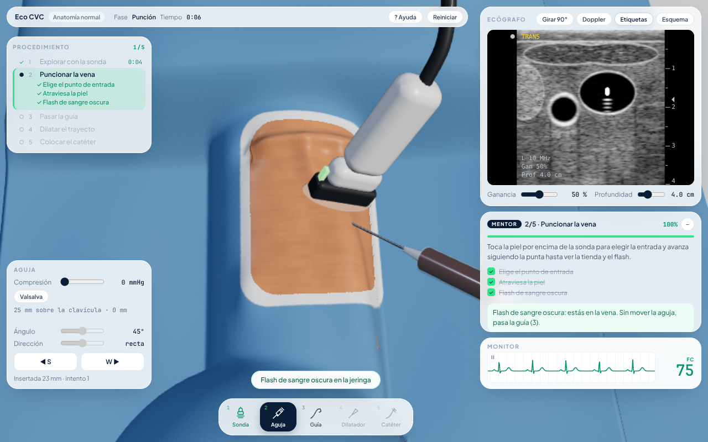
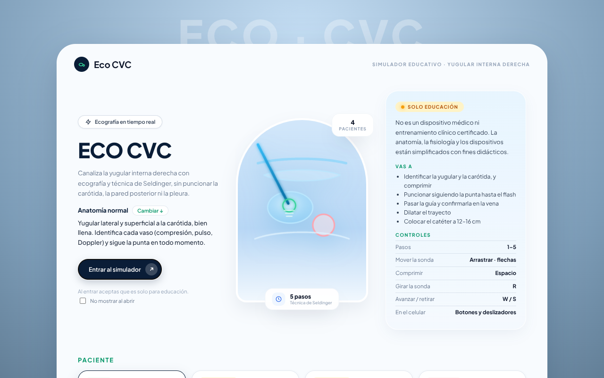
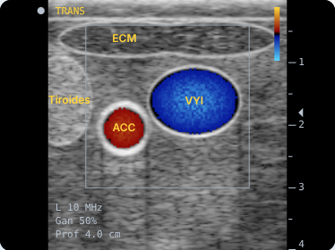
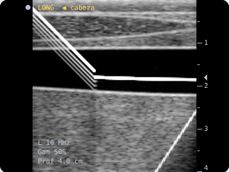
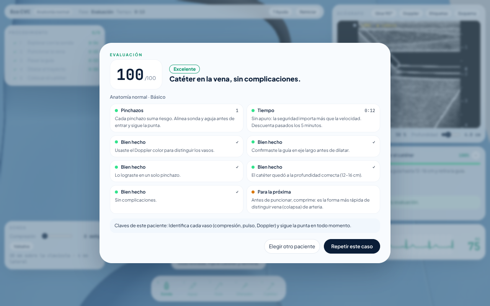

# Eco CVC — acceso venoso central guiado por ultrasonido



> **Solo para educación y demostración.** No es un dispositivo médico ni entrenamiento clínico certificado. La anatomía, la fisiología y los dispositivos están simplificados con fines didácticos.

Simulador en el navegador para canalizar la **vena yugular interna derecha** con ecografía en tiempo real y **técnica de Seldinger**, sin puncionar la carótida, la pared posterior de la vena ni la pleura.

**En vivo:** https://marie-lucy.github.io/us-guided-cvc-sim/

## Qué se hace

1. **Explorar** con la sonda y reconocer qué vaso es cuál. La vena colapsa al comprimir; la carótida pulsa y no colapsa. El Doppler color ayuda.
2. **Puncionar**: elegir el punto de entrada y el ángulo, avanzar siguiendo la punta en la imagen, ver la tienda (*tenting*) de la pared y el flash de sangre.
3. **Guía**: pasarla por la aguja, retirar la aguja y confirmar la guía dentro de la vena, idealmente en eje largo.
4. **Dilatar** el trayecto y **colocar el catéter** a 12–16 cm; retirar la guía.
5. **Evaluación**: pinchazos, tiempo, complicaciones con su explicación, aciertos y consejos.

Cada paso exige lo que exige en la clínica: sin flash no se pasa la guía, sin confirmar la guía no se dilata.

### La pantalla

Comparte la identidad visual de [Lab Theme](https://github.com/Marie-Lucy/lab-sim) y del [simulador de clipaje de aneurisma](https://github.com/Marie-Lucy/brain-surgery-sim): la escena 3D ocupa toda la pantalla y encima flotan paneles claros.

- **Barra superior:** paciente, fase, tiempo, ayuda, reiniciar y terminar.
- **Procedimiento** (izquierda): los cinco pasos con sus tareas y el tiempo de cada uno.
- **Herramienta** (abajo a la izquierda): los controles de la sonda, la aguja, la guía, el dilatador o el catéter.
- **Ecógrafo** (derecha): la imagen, con girar 90°, Doppler, etiquetas, esquema, ganancia y profundidad.
- **Mentor:** el objetivo del paso, sus tareas, una pista según lo que está pasando y *¿Por qué este paso?*.
- **Monitor:** ECG y frecuencia cardiaca.
- **Barra de herramientas** (abajo): un botón por paso, con teclas 1–5. Un paso bloqueado explica por qué.



### Pacientes

| Paciente | Dificultad | Qué cambia |
|---|---|---|
| Anatomía normal | Básico | Yugular lateral y superficial a la carótida, bien llena. |
| Obeso | Intermedio | 8 mm más de grasa subcutánea: los vasos quedan casi 1 cm más profundos. |
| Hipovolémico | Intermedio | Vena chica y aplanada, presión venosa de 1 mmHg: colapsa con la respiración y con muy poca presión, y hace más tienda. |
| Variante anatómica | Avanzado | La yugular está encima de la carótida: atravesar la pared posterior es entrar a la arteria. |
| Yugular trombosada | Avanzado | Un trombo oclusivo ocupa el tramo bajo y medio: la vena no colapsa, se ve gris por dentro, no tiene flujo ni refuerzo posterior. Hay que encontrar el tramo libre, más arriba. Puncionar el trombo no da flash y es una complicación grave. |

### Ver una demostración primero

En la portada, **Ver una demostración primero** hace el caso normal solo, paso a paso: explora, comprime, enciende el Doppler, punciona, pasa la guía, la confirma en eje largo, dilata y coloca el catéter. El mentor narra cada paso. Con cualquier clic o tecla tomas el control y sigues desde donde quedó. Al terminar se muestra la evaluación, que no se guarda en el historial.

### Práctica y examen

En la pantalla de inicio se elige el modo:

- **Práctica:** mentor con tareas, pistas y *¿Por qué este paso?*; Doppler, etiquetas y esquema disponibles; sin límite de tiempo.
- **Examen:** sin Doppler, etiquetas, esquema ni pistas, y con **8 minutos**. El mentor solo muestra el reloj (ámbar en el último minuto). Si se acaba el tiempo, el caso se cierra y el puntaje máximo depende de los pasos completados.

El **paciente sorpresa** elige uno de los cinco al azar y no dice cuál hasta la evaluación: hay que explorar para saber qué se tiene enfrente. El intento cuenta para la mejor marca del paciente real.

Cada intento queda en el **historial** del navegador; la portada muestra los últimos y el mejor puntaje en examen de cada paciente.

### Controles

| Acción | Ratón y teclado | Táctil |
|---|---|---|
| Mover la sonda | Arrastrar · flechas | Arrastrar |
| Comprimir | Mantener `Espacio` | Deslizador «Compresión» |
| Girar la sonda 90° (eje largo) | `R` | Botón «Girar sonda» |
| Avanzar / retirar aguja, guía, dilatador o catéter | Mantener `W` / `S` | Mantener los botones |
| Elegir la entrada de la aguja | Clic en la piel (fase Punción) | Tocar la piel |
| Ir a un paso | `1`–`5` o la barra de herramientas | La barra de herramientas |

## La física que usa

Todo el simulador sale de unas pocas diferencias reales entre la yugular y la carótida, y de cómo el ultrasonido convierte tejido en brillo. Las constantes están en `src/config/`, con su unidad y su motivo.

### Por qué la vena colapsa y la arteria no

Una sola regla para los dos vasos, la **ley del tubo**: un vaso se abre o se aplasta según la presión transmural (presión interna − presión de la sonda).

```
apertura = 1 + (P_interna − P_sonda) / 12 mmHg      (limitada entre 0.07 y 1)
```

La sonda llega a 40 mmHg: supera la presión venosa (~6 mmHg) pero no la diastólica de la carótida (~75 mmHg). La vena se aplasta **desde arriba** (la pared posterior no se mueve) y se ensancha hacia los lados. Valsalva sube la presión venosa: la vena se distiende y cuesta más colapsarla.



### La imagen

La ecografía se calcula pixel por pixel en un shader de WebGL (Three.js):

- **Speckle:** el granulado sale de sumar las ondas de miles de dispersores fijos en el tejido (suma coherente con la forma del haz), como en la física real. No parpadea y cambia de a poco al mover la sonda. Se promedian dos vistas, como en la imagen compuesta de las sondas lineales.
- **Reflectividad por tejido:** grasa oscura con septos, músculo con motas, tiroides homogénea y brillante, sangre anecoica.
- **Paredes especulares:** brillan más donde el haz las golpea de frente (techo y piso del vaso); la carótida tiene doble línea (íntima y adventicia).
- **Atenuación:** el tejido atenúa y la sangre casi no, así que detrás de los vasos llega más señal (**refuerzo acústico posterior**). Hay sombras de refracción bajo los bordes laterales.
- **Pleura:** línea muy brillante con **líneas A** (reverberaciones a múltiplos de su profundidad) y deslizamiento con la respiración.
- **Compresión logarítmica** a grises, como un ecógrafo real.

### La aguja y la trampa fuera de plano

La aguja es un segmento recto: punto de entrada **e**, dirección unitaria **d** y largo insertado *L*. El haz es un plano con un punto **p₀** y una normal **n**. Lo que aparece en la imagen es la intersección:

```
t = ((p₀ − e) · n) / (d · n)        x = e + t·d        (visible solo si 0 ≤ t ≤ L)
```

En vista transversal **n** = (0, 0, 1) y la fórmula queda `t = (posición de la sonda − e.z) / d.z`. El haz tiene ~1.5 mm de grosor, así que se dibuja el tramo entre sus dos caras: un punto brillante con cola de cometa.

**La trampa:** si *L* > t, la punta ya pasó el plano y el punto brillante es el **cuerpo** de la aguja, no la punta, que está (L − t)·sen(α) más profunda. Es la causa más común de punción de la pared posterior o de la carótida en la vida real, y el simulador la reproduce: un test lo verifica.

La punta se evalúa con el corte anatómico a **su** altura: empuja la pared (tienda) hasta 4 mm antes de perforarla. Si la vena está colapsada y es más fina que eso, la punta la atraviesa entera sin flash.

### Eje largo

Con la sonda girada, el haz es el plano x = lateral. Cada columna de la imagen es el corte transversal a otra altura del cuello, que el shader recibe en una textura. Así se ve la aguja en plano y la guía dentro de la vena, que solo aparece si la sonda está alineada con ella (dentro del grosor del haz).



### Trombosis

El trombo se describe en la anatomía del paciente como la fracción de la luz que ocupa a cada altura del cuello (desde la pared posterior hacia arriba). De esa sola cifra sale todo lo que se ve:

- **No colapsa:** la apertura de la vena no puede bajar de la fracción ocupada (`apertura = max(ley del tubo, ocupación)`), ni cambia con la respiración o Valsalva.
- **Imagen:** material gris y heterogéneo donde debería verse la sangre negra, y **sin refuerzo posterior** porque el coágulo atenúa como tejido.
- **Doppler:** sin flujo dentro del trombo. En eje largo se ve la punta del trombo con flujo por encima.
- **Aguja:** la pared casi no hace tienda (el coágulo la sostiene) y dentro del trombo no sale sangre.

### Seldinger y ECG

La guía solo avanza si la punta estaba dentro de un vaso; si no, encuentra resistencia. Pasados ~17 cm aparece **ectopia ventricular** en el ECG (derivación II con extrasístoles: QRS ancho, sin onda P, T invertida), que cede al retirarla. Dilatar con la guía en la carótida queda registrado como complicación grave.



## Desarrollo

```bash
npm install
npm run dev     # servidor local
npm test        # tests (Vitest)
npm run build   # chequeo de tipos + build de producción
```

- **TypeScript** estricto + **Vite**; **Three.js** para la vista 3D y el shader de ecografía.
- La lógica (anatomía, física, aguja, Seldinger, evaluación) es pura y está cubierta por tests en `tests/`.
- La calidad de dibujo se adapta sola: si los cuadros tardan, baja la resolución (y apaga las sombras del 3D); la escena 3D solo se redibuja cuando algo cambia.
- En modo desarrollo, `window.__simulador` permite manejar el simulador desde la consola.

### Estructura

```
src/
  config/        constantes con nombre (anatomía, ultrasonido, aguja, procedimiento, evaluación…)
  core/          máquina de estados con requisitos por fase, matemática, rendimiento
  anatomia/      modelo paramétrico del cuello en mm (ley del tubo, pulso, respiración)
  ultrasonido/   shader, vista mm↔px, eje largo, overlay del ecógrafo, esquema plano
  escena/        vista 3D: cuello, campo estéril, sonda, aguja y herramientas
  aguja/         segmento, cruce con el haz, tienda, perforación, eventos
  procedimiento/ técnica de Seldinger y ECG
  casos/         pacientes
  evaluacion/    registro de la sesión y evaluación final
  ui/            HUD (procedimiento, mentor, barra, avisos), guía de pasos, inicio, evaluación, ECG, estilos
```

### Publicación

Cada push a `main` (o `master`) corre los tests, compila y publica en GitHub Pages (`.github/workflows/deploy.yml`). La primera vez hay que activar Pages en **Settings → Pages → Source: GitHub Actions**; GitHub no deja que el workflow lo active solo.

El sitio se sirve en `/us-guided-cvc-sim/` (lo fija `base` en `vite.config.ts`): si el repositorio cambia de nombre, hay que cambiar también esa línea.
